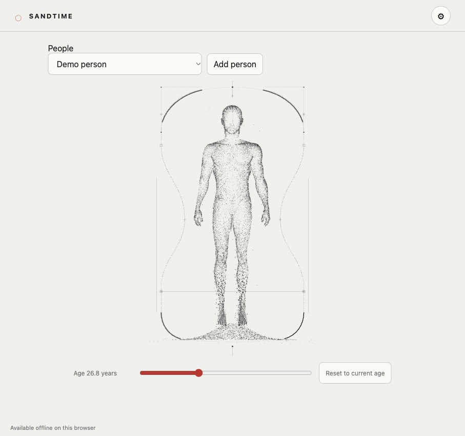

# Sandtime

[English](README.md) · [简体中文](README.zh-Hans.md) ·
[繁體中文](README.zh-Hant.md) · [日本語](README.ja.md) · [한국어](README.ko.md)
· [Español](README.es.md)

Reloj de arena local e independiente para reflexionar sobre una vida. Sin datos
personales por defecto: define nacimiento/vida objetivo, previsualiza edad y
ajusta figura, arena, movimiento y tema. No requiere cuenta ni servicio remoto.

## Vista de ejemplo

Captura real con datos ficticios: Demo person, fecha de nacimiento 2000-01-01 y
una vida objetivo de 80 años. El tiempo mostrado cambia con el reloj. La
interfaz de esta captura está en inglés.

## Datos e importación

Perfiles/ajustes viven en este browser y origin. Exporta backup antes de borrar
datos o cambiar dirección. Importa explícitamente backup Sandtime,
family.lifeCountdown/ajustes Hourglass de Prometheus o profiles/items heredados.
Prometheus añade; backup Sandtime reemplaza tras confirmar. Duplicados
familiares/exceso se rechazan sin cambiar datos.5MB/archivo,1000personas,
nombres200caracteres. Fechas parciales son aproximadas; archived/pinned
heredados se conservan en backup, sin aplicarlos a la lista.

## Offline y opciones

Tras la primera visita online funciona offline en origins/browsers con service
worker. Guardar requiere origen seguro/Web Locks; recarga tras cambios de otra
tab y cierra/recarga tabs antiguas antes de upgrade. Respeta reduced-motion y
permite System/Pixel, temas, figura y velocidad/arena.

## Ejecutar

Deno con deno bundle. deno task build y preview imprimen URL loopback efímera;
check verifica tipos e importación/persistencia. Esta revisión no importa
perfiles personales, resetea ni toca datos reales.

El build también incluye la licencia del proyecto sin cambios en
`dist/LICENSE.txt` y todos los avisos y la procedencia de las fuentes existentes
en `dist/font-notices.txt`.

## Fuente y derechos

El código conserva GPL-3.0-only. El atlas anatómico,
la geometría y el render proceden del prototipo y de una aplicación anterior del
propietario, con hash y confirmación fechada en
README inglés. DeparturePixelZh Compact conserva OFL1.1 y notices. Publicar una compilación o alojar la aplicación son decisiones separadas.

Font preparation / 字型準備 / 字体准备: see [README](README.md#font-preparation).
